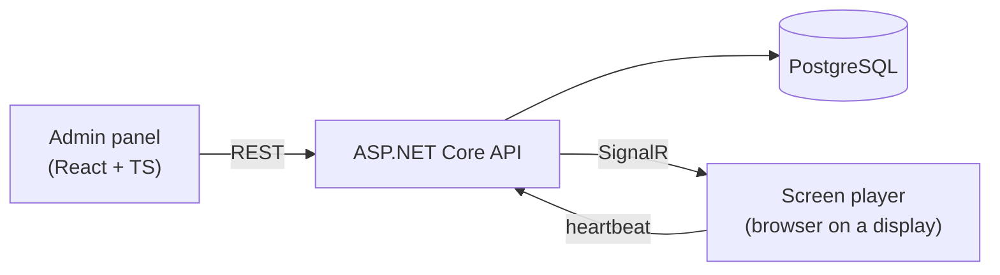

# Vitrin

**A digital signage management platform.** Upload images and videos, build playlists, schedule them, and push content to screens in real time — while watching which screens are online.

> 🚧 **Status: in active development.** This README describes the target product; the roadmap below shows what is already built.

---

## Why Vitrin?

Retail stores, cafés and offices use screens to show menus, campaigns and announcements. Updating them usually means someone walking to each screen with a USB stick. Vitrin lets an editor change what every screen shows from a single web panel, and the change appears instantly.

## Planned features

- **Screen management** — register screens with a 6-digit pairing code, group them by location
- **Content library** — upload images and videos
- **Playlists & scheduling** — e.g. breakfast menu 09:00–12:00, lunch menu afterwards
- **Real-time updates** — content changes reach screens instantly via SignalR, no page refresh
- **Live status** — see which screens are online or offline (heartbeat)
- **Roles** — Admin and Editor permissions with JWT authentication

## Tech stack

| Layer | Technology |
|---|---|
| Backend | C# · ASP.NET Core Web API (.NET 10) |
| Real-time | SignalR |
| Database | PostgreSQL · Entity Framework Core |
| Frontend | React · TypeScript · Vite · TanStack Query · Tailwind CSS |
| Testing | xUnit |
| DevOps | Docker Compose · GitHub Actions |

## Architecture



## Roadmap

- [x] Project setup — ASP.NET Core Web API scaffold
- [x] Screens API — first domain model and CRUD endpoints
- [x] Database — PostgreSQL with EF Core migrations
- [ ] Media upload — image/video library
- [ ] Admin panel — React + TypeScript
- [ ] Screen player + real-time content push (SignalR)
- [ ] Playlists, scheduling, online/offline status
- [ ] Authentication, roles and screen pairing
- [ ] Tests, error handling, logging
- [ ] Docker Compose + CI with GitHub Actions
- [ ] Live demo deployment

## Getting started

**Requirements:** [.NET 10 SDK](https://dotnet.microsoft.com/download)

```bash
git clone https://github.com/idilorul/vitrin.git
cd vitrin/backend/Vitrin.Api
dotnet run
```

The API starts on `http://localhost:5224`.

## Project structure

```
vitrin/
├── backend/
│   ├── Vitrin.slnx          # .NET solution
│   └── Vitrin.Api/          # ASP.NET Core Web API
└── frontend/                # React + TypeScript (coming soon)
```

## Author

**Eylül İdil Orul** — [GitHub](https://github.com/idilorul) · [LinkedIn](https://www.linkedin.com/in/eylul-idil-orul)